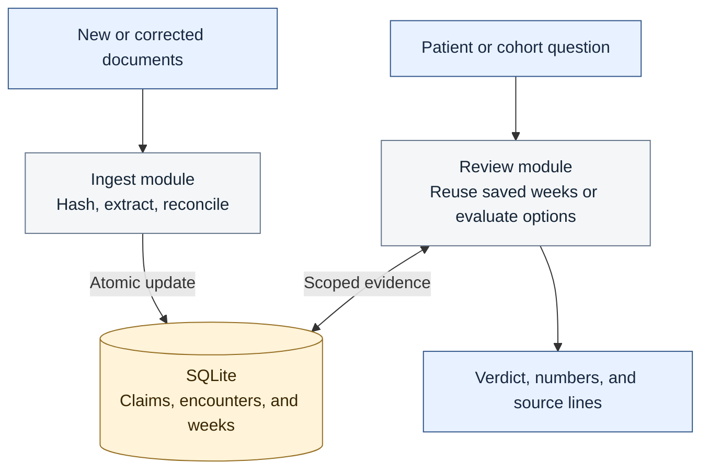
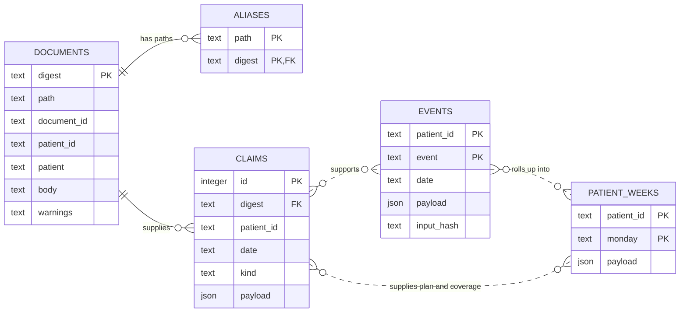
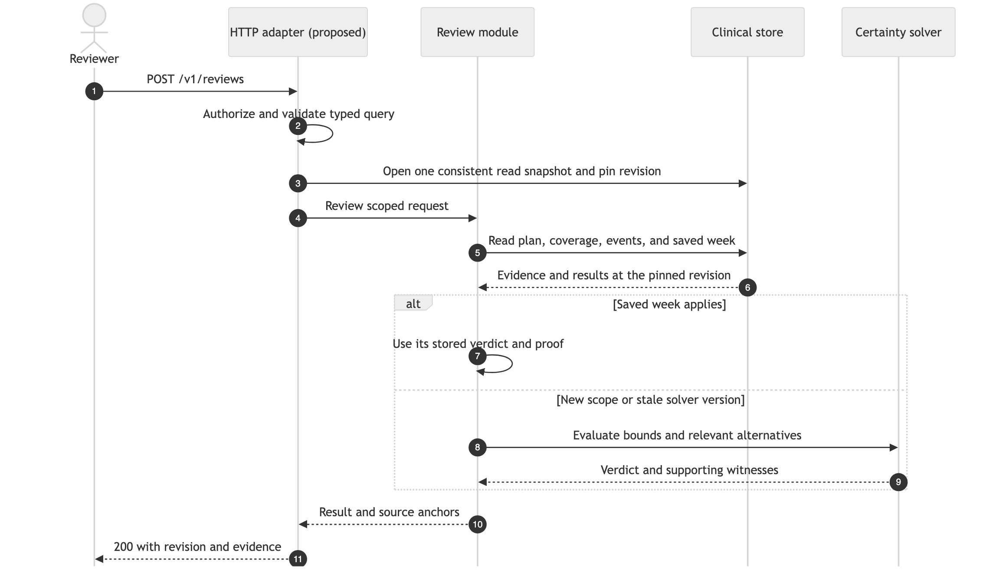
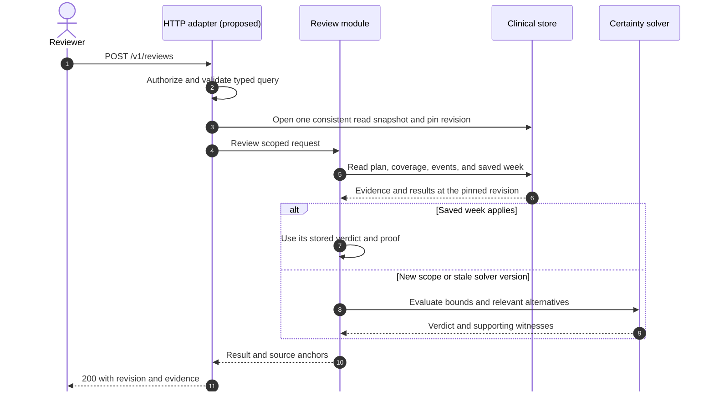
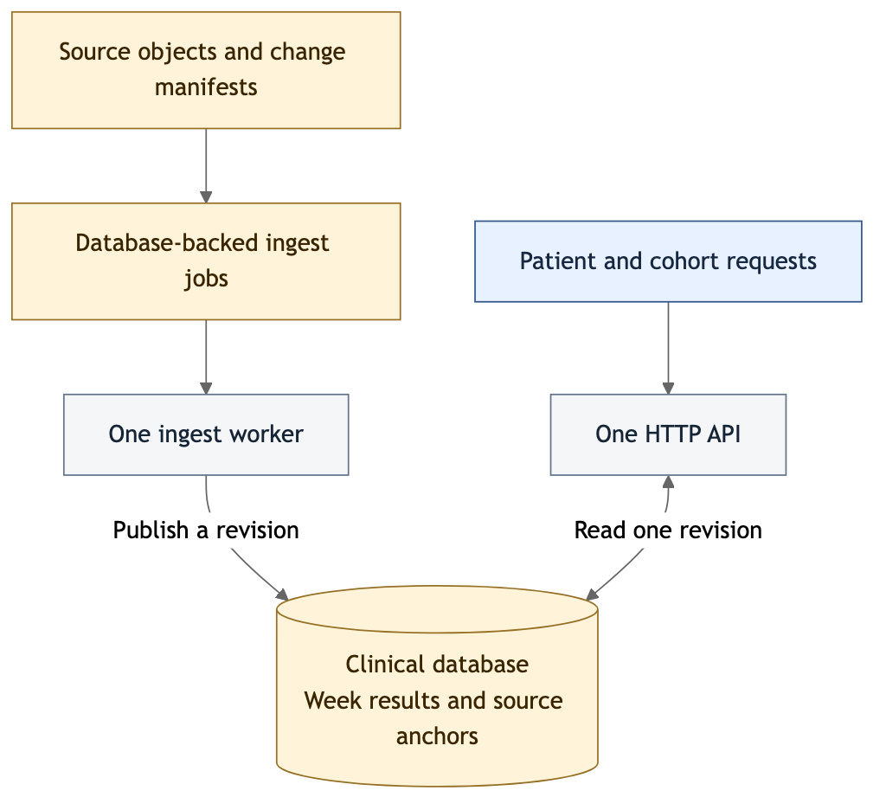
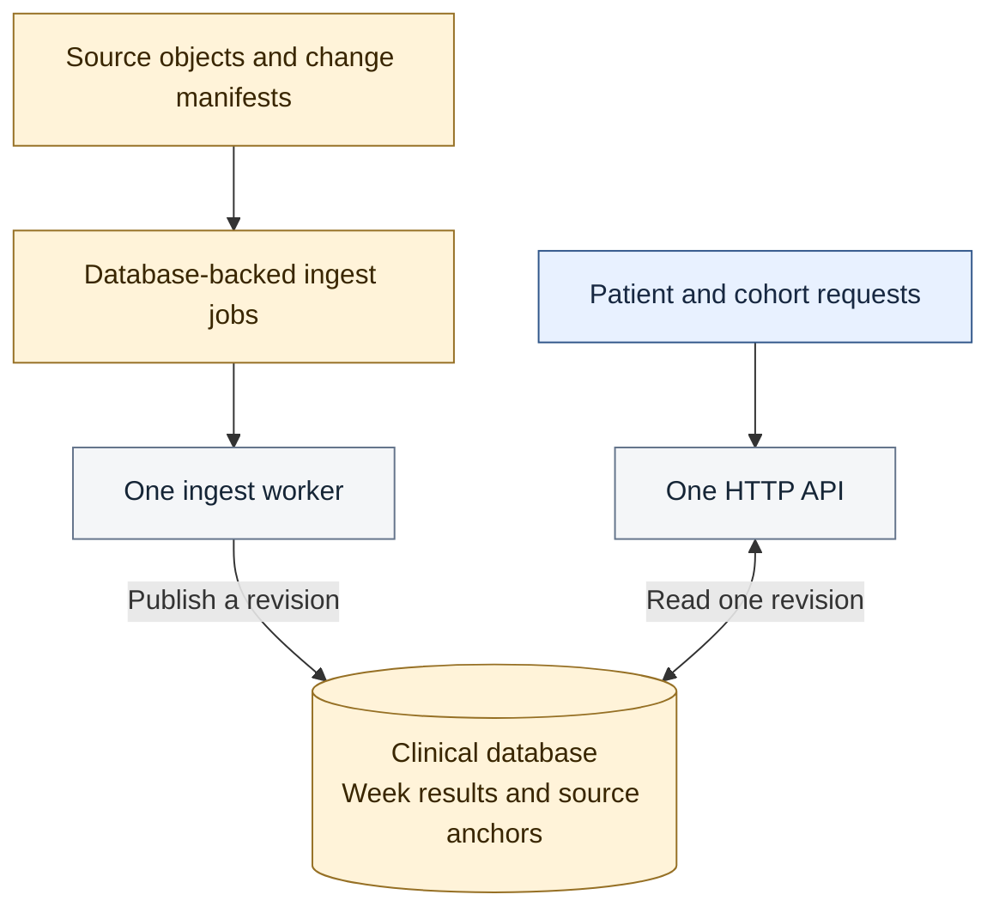

# Backbone · Clinical evidence ledger

A Python and SQLite prototype for auditing what care a patient received. Import the documents once, then answer new patient and cohort questions from saved evidence. Each computed answer can be traced to source lines.

[Run it](#run-locally) · [System design](#system-design-whiteboard) · [HTTP contract](#http-contract-proposed) · [Scale plan](#design-for-500000) · [Cohort optimization](#next-optimization) · [Validation](#why-these-designs-earned-their-place)

## Run locally

**macOS (Apple Silicon).** Download [the release ZIP](https://github.com/ShangChienLiu/backbone-clinical-review/releases/latest), unzip it, and double-click **Start.command**. The release includes its Python runtime and the saved demo database.

Choose **1** for the five original questions, **2** for a patient review, **3** for a collection review, **4** to import a document folder, or **5** to save the last review or full abstraction as JSON. Reviews, imports, and exports run locally. The working database and exports are under `.backbone/` next to the launcher. Use `--workspace /path/to/folder` to store them elsewhere.

The import report distinguishes new evidence, files stored for review with no extracted evidence, reused files, and files that failed to read. Collection review saves a summary of matching patients and weeks. Open a patient review for the source evidence, or use the scriptable CLI for a detailed collection report.

**From source.** Run `python3 terminal.py` with Python 3.10 or newer. The guided terminal and the scriptable CLI share the same SQLite review engine. The bundled text files are ready to import. Text-layer PDFs use Poppler's `pdftotext`, basic DOCX extraction is supported, and scanned PDFs require OCR text.

```sh
python3 clinical.py --db review.sqlite ingest documents
python3 clinical.py --db review.sqlite answer questions.json
python3 clinical.py --db review.sqlite ask 'How much therapy did Rowan receive January 19–25, 2026?'
python3 clinical.py --db review.sqlite export > abstraction.json

# Later, import a folder containing the new delivery.
python3 clinical.py --db review.sqlite ingest /path/to/new-delivery
```

`ask --patient NAME --start YYYY-MM-DD --end YYYY-MM-DD` supplies an explicit scope. A question in `answer` may inherit the preceding question's scope for the same patient. Use `week of YYYY-MM-DD` for a Monday–Sunday review. Unsupported free-text questions exit with code 3 and print the supported reviews to standard error. A mixed import still saves readable files and exits with code 2 if any file failed. Use [the saved combined database](outputs/combined.sqlite) for questions about the three-patient example.

## System design whiteboard

### What runs today

The write and read paths use one Python program and one SQLite file. Each CLI invocation runs in one process. A SQLite write transaction publishes the new source claims, revised encounters, and affected weeks together.


<details>
<summary>Mermaid source</summary>



</details>

- **Write.** SHA-256 identifies byte-identical inputs. A new alias is saved if the path changed. A new document is extracted into source-anchored claims. Encounter fingerprints identify affected projections. Plan and coverage changes can refresh a week without rewriting its encounters. A file with zero extracted evidence remains in the ledger and stays visible for review on retry.
- **Read.** A patient review uses saved encounters and week results. A collection summary reads current week metadata in one SQLite query. It evaluates missing, clipped, or stale weeks from the same snapshot, using the same evaluator as patient review. The numeric path runs Python and SQLite with zero model calls.

Code entry points are [guided terminal](terminal.py), [scriptable CLI](clinical.py), [ingest and storage](ledger.py), [encounter reconciliation](reconcile.py), and [review queries](review.py).

### Schema in the shipped SQLite file


<details>
<summary>Mermaid source</summary>



</details>

JSON payloads are stored as SQLite text. `claims.payload` includes the assertion, role, verbatim excerpt, and source line. Plans, coverage and measures are claim kinds. `events.payload` records resolved fields and alternatives. `patient_weeks.payload` stores the result, coverage, witnesses and solver version. Dotted arrows show how results are derived. They are logical dependencies. The two foreign keys in the diagram point to `documents.digest`. A separate `meta` table records the extractor version. [SQLite DDL](ledger.py)

### HTTP contract (proposed)

The repository ships a CLI. These three routes describe a future HTTP adapter over the same ingest and review logic.

| Route | Request | Response |
| --- | --- | --- |
| `POST /v1/ingest-jobs` | `manifest_id` and `Idempotency-Key`. The manifest references immutable input objects and checksums in the caller's collection. | `202` with a job ID |
| `GET /v1/ingest-jobs/{id}` | Job ID | State, file errors, recomputation counts, and the committed revision when successful |
| `POST /v1/reviews` | Query type, inclusive date range, and patient ID for a patient review. Optional expected revision and evidence detail. | `200` with the read revision, typed result, and source anchors |

Review types map to the existing queries: `weekly_goal`, `dose_summary`, `day_reconstruction`, `symptom_evidence`, `plan_change`, and `consecutive_below_goal`. Evidence detail defaults to `summary`. Use `detail: "evidence"` for the full trace. The adapter validates authorization, the date range and the query type. A repeated ingest request with the same key and manifest returns the same job. Reusing the key with a different manifest returns `409`. The adapter checks an optional revision against the committed revision inside the same read snapshot used for the answer. A mismatch returns `409` so the caller can restart. The revision in a successful response identifies the snapshot actually read.

**Example patient review request**

```json
{
  "type": "weekly_goal",
  "patient_id": "HG-M042",
  "range": {"start": "2026-01-26", "end": "2026-01-30"},
  "detail": "evidence"
}
```

**Selected response fields**

```json
{
  "revision": "r17",
  "status": "cannot_determine",
  "coverage_complete": false,
  "goal": {"days": 3, "minutes": 150},
  "witnesses": [
    {"passes": false, "days": 3, "minutes": 145, "disputed_source": "BH-D111:7"},
    {"passes": true, "days": 3, "minutes": 155, "disputed_source": "BH-D110:7"}
  ]
}
```

The revision is illustrative. The two witnesses use the recorded signed alternatives. `disputed_source` identifies the assertion that changes the result. The full evidence response would include the remaining source anchors and evidence excerpts. [Computed DEV-03](outputs/development-answers.json)

### One review request, end to end



<details>
<summary>Mermaid source</summary>



</details>

The proposed adapter keeps every read for one request in the same snapshot. If a signed correction commits while that request runs, its result finishes on the prior revision. A later request reads the new revision. The ingest worker declares a revision ready only after the associated projections commit. If a required source fails, the job reports the error and the previous revision stays active. A successful manifest tells us which files arrived. A shortfall still requires clinical coverage evidence for that week.

### Design for 500,000

**500,000 documents is a storage and ingestion problem.** The existing study measured one amendment in a **6,500-document** synthetic collection. Incremental update took **1.735 ms** locally versus **2,131.540 ms** for a fresh rebuild. The saved clinical outputs matched. Use immutable source objects and a manifest of changes so routine ingestion visits new deliveries. Keep indexed patient, date and week keys, and replay only affected projections. The current implementation still reads the affected patient's claims to regroup them. A 260-week chart measured **5.154 ms** for one amendment, making encounter-scoped lookup the next candidate if long charts dominate. These are local measurements on generated layouts. [Validation report](outputs/design-validation.md)

The 6,000-file synthetic run spent **3.82 of 5.07 seconds** in extraction in `ledger.ingest()`. If a 500,000- or million-file corpus has similar layouts, per-document extraction is the first cold-import bottleneck to investigate. Batch work outside the publish transaction and key extraction reuse by content and extractor version. A million-file run and production document mix still need measurement. [Synthetic scale measurements](outputs/synthetic-scale.json)

**500,000 requests needs a time window.** As a sizing example, **500,000 requests/day** is **5.8 requests/s** on average. A hypothetical 10× peak is about **58 requests/s**. Separate patient lookups from cohort scans in the load test. Measure HTTP p95, contention, import lag, and response size under concurrent writes. The local ingest benchmark does not establish an HTTP capacity or latency target.

On the 6,500-document synthetic collection, the terminal's summary path took **69.85 ms** versus **205.05 ms** for a detailed cohort report, medians from nine in-process runs covering 250 patients and 24 weeks each. Both found the same patients and week pairs. The summary reuses saved results for matching date slices and recomputes stale or clipped weeks.



<details>
<summary>Mermaid source</summary>



</details>

A database-backed job table is enough to start. The worker and API can share a deployment. Introduce each extra piece when the corresponding bottleneck is measured.

| Observed limit | Next change |
| --- | --- |
| Backfills delay requests or imports fall behind | Run the ingest worker separately. Track the oldest job and retry by manifest identity. |
| Long charts make updates expensive | Index claim dependencies by patient and encounter. Expand to other dates only for affected shared evidence or plan periods. |
| A single writer or shared-file deployment limits concurrency | Move the same tables and transaction semantics to PostgreSQL. Serialize concurrent changes for the same patient. |
| Cohort queries remain slow after batching | Profile JSON decoding and repeated slice misses. Page at one revision and load proof details for selected results. |
| Identical queries still dominate the read budget | Cache by collection, access scope, data revision, normalized query, evidence detail, and solver version. |

The deployment preserves the same ingest and review interfaces as the workload grows. Each new process has a measured reason to exist.

## Next optimization

**Shipped in v1.2.** Cohort summary selects the fields used for discovery in one ordered read over the existing week table. It streams the saved results patient by patient and uses one read transaction for the projection and any fallback. The summary interface and SQLite schema stay the same. SQLite builds without JSON functions use the per-patient read path.

| Local test, 6,500 base files and 250 patients | v1.1 compact review | v1.2 batched review | Weeks recalculated |
| --- | ---: | ---: | ---: |
| Full 24-week window | 71.56 ms | 49.50 ms | 0 |
| Both endpoint weeks clipped | 89.87 ms | 63.45 ms | 500 |
| Missing rows and old solver versions | 92.11 ms | 71.38 ms | 1,091 |
| Empty week cache | 133.80 ms | 133.84 ms | 6,000 |

Both versions returned identical summaries, including pair classifications, encounter IDs, coverage flags, and patient ranges. These are local in-process medians of 11 runs per case. With an empty week cache, nearly all the work is in the evaluator. Concurrency and capacity at 500,000 documents still require a load test.

<details>
<summary>Benchmark setup</summary>

Generate the input with `build_documents(root, 250, 24)`. Ingest the base delivery and its single amendment. The full range is April 6 through September 20, 2026. The clipped range is April 8 through September 18. For the mixed case, remove week rows with `rowid % 10 = 0`, then set the solver version of the remaining rows with `rowid % 11 = 0` to zero. For the empty-cache case, clear the week table. Run `cohort_review(..., compact=True)` from each version against the same database. Alternate the execution order and compare the full output after every timed run. [Synthetic generator](validate_design.py)

</details>

### Keep the same answer when a cached week is missing

1. Start from the selected patients and derive their expected weeks from the requested range and any single documented episode. A patient with zero saved rows still needs evaluation.
2. Read week fields in one batch, then stream by patient and Monday. A usable row matches the patient, Monday, exact evaluated dates, and solver version. Ingest updates or invalidates every affected week in the same transaction as the supporting claims. A coverage amendment can affect neighboring weeks even when their dates and solver version match. Recompute only the mismatched or absent slices using the shared evaluator.
3. Compare consecutive calendar weeks with the existing pair rules. Load proof and source excerpts only for details requested at that revision. A visit with an unresolved date, missing coverage, or disputed duration must preserve the evaluator's uncertainty.

If users repeatedly query the same clipped weeks, cache those exact slices on demand and evict cold entries. If profiles show JSON decoding dominates, benchmark a typed projection under simultaneous reads and corrections. The earlier typed-row experiment reached **22.69 ms** for the aligned window, with projection maintenance outside the measurement. For continuously refreshed cohort reports, incremental view maintenance can publish removed and added week results from a committed revision. A changed week can affect both adjacent pairs. [Research and trade-offs](docs/optimization-research.md)

### Keep file reading off the write transaction

For recurring deliveries, keep one ingest job per manifest. Read each immutable file once and hash and extract from the same bytes. Keep this work outside the write transaction. When publishing, recheck the content hash against the database, write new claims, and update the affected encounters and weeks atomically. A read-only existence check can skip extraction for known hashes. The write transaction still checks for competing imports.

The filename can supply a document ID or a missing year. In a synthetic check, the same body containing “April 6” produced service dates in 2026 and 2027 under two different filenames. Use the digest for byte deduplication. Add the extractor version and relevant filename context to any extraction cache key, or establish a canonical source name before extraction. A manifest tracks file delivery. Evidence of complete clinical attendance still comes from the chart. [Filename fallbacks](extract.py#L130)

For long charts, consider indexed replay for amendments with an unambiguous encounter ID. Keep whole-patient regrouping for changes to shared rules, coverage, plan dates, or unresolved encounter links. In a synthetic stress check, one amendment recomputed one encounter and one week for both 260- and 1,040-week charts. Median import time over seven runs rose from **5.09 ms to 17.93 ms**. The existing implementation still reads and fingerprints the affected patient's claims.

Before rollout, compare batched results with the evaluator on clipped weeks, stale or missing rows, sparse charts, and late amendments. Include a coverage amendment that crosses saved weeks and two workers replaying the same bytes under different filenames. Compare interrupted and retried imports with a serial run. Measure p95, rows read, fallback counts, and writer lock time under a mixed import and query workload.

GPT-6.2 Astra reviewed the batch query and its fallback against an uncached run. Claude Fable 5.2 reviewed transaction staging and competing retries. Gemini 4 Hydrogen reviewed cross-week invalidation and the cost of materializing adjacent pairs. The prototypes and comparisons above were run locally against the existing evaluator.

## Why these designs earned their place

| Design | Evidence |
| --- | --- |
| **Preserve the source and recompute the projection** | A late departure amendment changes one encounter and one week. A byte-identical retransmission changes neither. An attendance coverage update can recompute one week and zero encounters. [Incremental work counters](outputs/benchmarks.json) |
| **Evaluate days and minutes in the same scenario** | A goal of 3 days and 150 minutes fails in both `(3, 145)` and `(2, 155)`. Separate bounds hide that fact. The joint solver agreed with exhaustive enumeration in **640/640** trials. The independent bounds baseline agreed in **520/640**. The difference came from the 120 deliberately correlated cases. [Validation study](outputs/design-validation.md) |
| **Finalize minutes once later choices cannot overlap them** | The solver preserves the attendance day and any clock positions that can still overlap. On a synthetic **16,384-combination** case, the previous solver reached its search limit. The new solver proved the shortfall in a median of **0.033 ms** and matched the exhaustive verdict. [Stress measurements](outputs/design-validation.json) |
| **Require coverage evidence for a shortfall** | In 120 withheld-document trials, treating the remaining records as complete caused 40 wrong definite verdicts. The coverage rule avoided all 40 and retained the 40 results already proven to meet the goal. [Validation study](outputs/design-validation.md) |

The case supporting a verdict is inspectable as dates, intervals and source lines. This is the prototype's use of explainable certain answers. [Amendola and Libkin, Explainable Certain Answers](https://ijcai.org/proceedings/2018/233)

## Results and reproducibility

- **Rowan.** 12 sessions on 11 days. The signed January 26 alternatives yield **585 or 595 minutes** overall. Jan 5 fell below goal and Jan 19 met it. Jan 12 lacks full coverage and Jan 26 spans the goal boundary. [Five development answers](outputs/development-review.md)
- **Multiple patients and a plan change.** [Collection review](outputs/evaluation-review.md) and [computed plan-change snapshot](outputs/plan-change.json) show the same abstraction handles the additional example charts.
- **Sources.** `documents/` has 31 development records. Two public mirrors match each other and both question files exactly match the provided `questions.json`. The organizer's Drive folder was unavailable. `evaluation-documents/` is a separate public example collection. [Pinned sources and checksums](source-manifest.json)
- **Tests and benchmarks.** The synthetic fixture schema has three fields, `id`, `add` and `expect`. The curated suite passed 26/26 deliveries. The development benchmark records initial and cached ingestion, warm and fresh-process queries, saved database size, and model use. [Fixture design](tests/edge_cases.md), [benchmark results](outputs/benchmarks.json)

```sh
python3 -m unittest discover -s tests -v
python3 edge_suite.py
python3 validate_design.py
sh reproduce.sh reproduced
```

## Limits and design review

Text extraction uses known document patterns. New layouts require a blinded recall and linkage study. The solver applies an explicit state limit and preserves an unresolved outcome if it cannot finish. Cohort uncertainty flags identify adjacent weeks for review. The current proof solver evaluates one weekly goal at a time.

Codex helped build and test the prototype. Gemini 3.8 Flash (Medium) independently reviewed the schema and the write/read diagrams. GPT‑OSS 120B (Medium) reviewed the API, job handling and concurrent reads. Both also reviewed the draft. The design uses one shared interface and checks the requested revision inside the same snapshot as its evidence reads. Proposed capacity estimates and deployment choices require a load test. Model-assisted fixture generation is documented separately. [Fixture generation record](tests/edge_cases.md)
