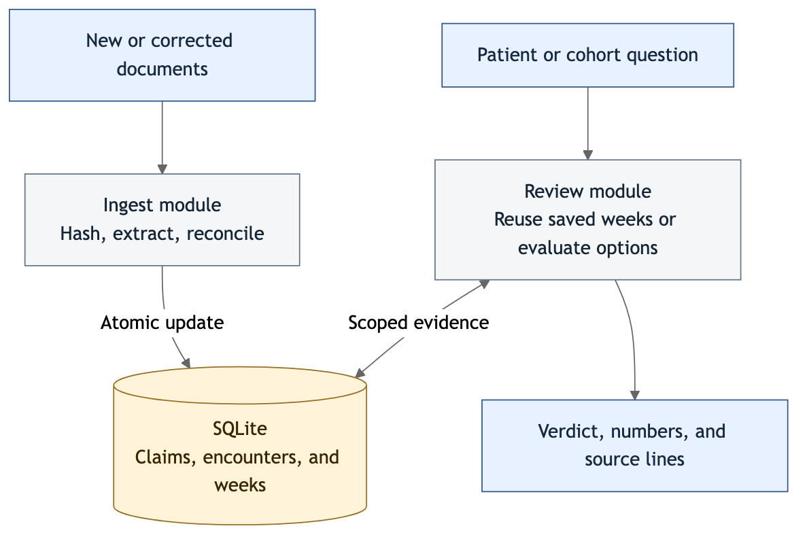
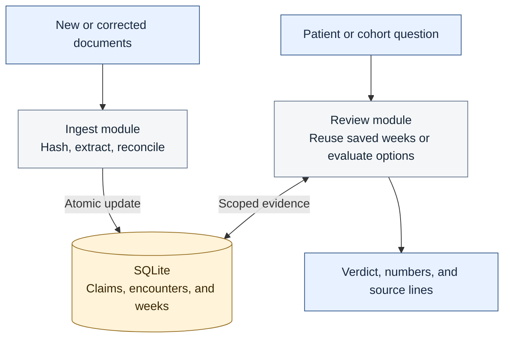
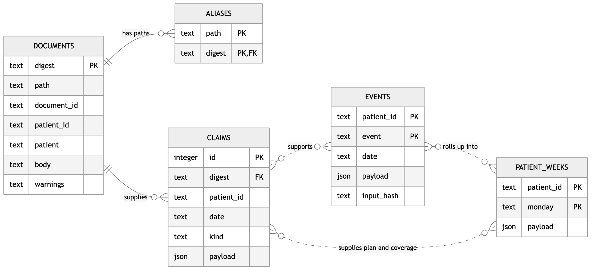
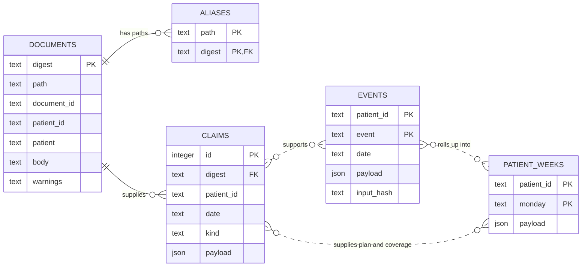
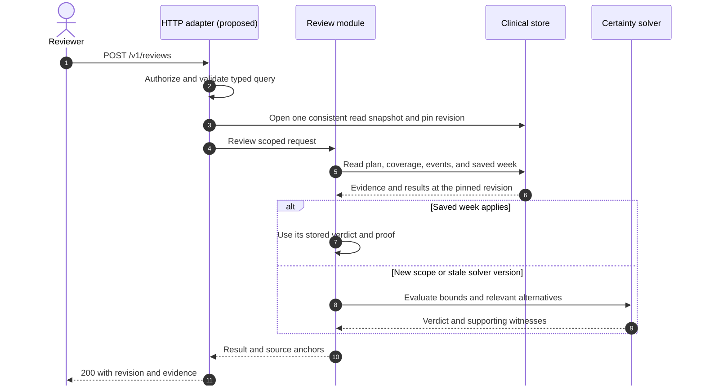
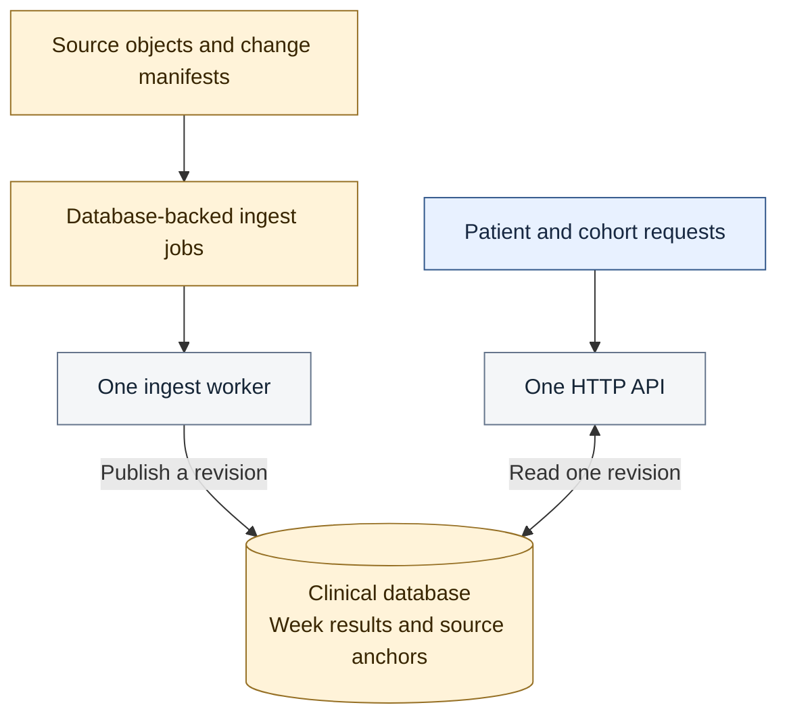

# Backbone · Clinical evidence ledger

A Python and SQLite tool for reviewing clinical records. Import documents once, then answer patient and cohort questions with numbers and source citations.

Two signed notes disagree about one of Rowan's sessions. The weekly total could be **145 or 155 minutes** against a **150-minute goal**. Backbone reports **cannot determine** and cites both notes. [Worked example](outputs/development-review.md)

[Run it](#run-locally) · [Take-home summary](#take-home-summary) · [System design](#system-design-whiteboard) · [HTTP contract](#http-contract-proposed) · [Scale plan](#design-for-500000) · [Trade-offs](#next-optimization)

## Run locally

On a Mac with Python 3.10 or newer, download and unzip the release, then double-click **Start.command**. The launcher uses your installed Python. The ZIP includes a demo database. [Download the Mac release](https://github.com/ShangChienLiu/backbone-clinical-review/releases/latest)

If you need Python, install it using the official macOS installer, then reopen **Start.command**. You can also open Terminal and run `python3 terminal.py` from the extracted folder. [Python for macOS](https://www.python.org/downloads/macos/)

Press **1** for the five original questions, **2** for a patient review, **3** for a cohort summary, **4** to import documents, or **5** to export JSON. The database and exports stay local under `.backbone/`.

To verify imports, unzip the fictional sample and import `01-original`. Review Avery Demo and expect **3 sessions on 3 days, 140 minutes, not met**. Then import `02-correction` and review again for **150 minutes, met**. The sample includes the expected import counts. [Download the import sample](https://github.com/ShangChienLiu/backbone-clinical-review/releases/download/v1.2.2/backbone-import-demo.zip)

From source, run `python3 terminal.py` with Python 3.10 or newer.

<details>
<summary>Scriptable CLI and input formats</summary>

```sh
python3 clinical.py --db review.sqlite ingest documents
python3 clinical.py --db review.sqlite answer questions.json
python3 clinical.py --db review.sqlite ask 'How much therapy did Rowan receive January 19–25, 2026?'
python3 clinical.py --db review.sqlite export > abstraction.json

# Later, import a folder containing the new delivery.
python3 clinical.py --db review.sqlite ingest /path/to/new-delivery
```

`ask --patient NAME --start YYYY-MM-DD --end YYYY-MM-DD` sets the review scope. Use `week of YYYY-MM-DD` for a Monday–Sunday review. Unsupported questions exit with code 3. An import with failed files saves the readable files and exits with code 2. The import report distinguishes usable evidence, files stored without evidence, reused files, and failures.

Text and DOCX files can be imported directly. Text-layer PDFs require `pdftotext`. Scanned PDFs require OCR text. Pass `--workspace /path/to/folder` to the guided terminal to use a different workspace. [Saved three-patient database](outputs/combined.sqlite)

</details>

## Take-home summary

- **Approach.** Hash files to detect duplicates, extract evidence with deterministic rules, and store quotes and source lines in SQLite. Reconcile conflicting records and recompute only the affected encounters and weeks. Reviews use the saved evidence and report uncertainty when the record does not settle a verdict.
- **Decision tested.** Batch the read of saved cohort weeks. On 6,500 synthetic files, the median for a full-window summary dropped from **71.56 ms to 49.50 ms** with identical output. With an empty week cache, both versions took about **134 ms**. Batching pays off when prior results can be reused. [Benchmark and trade-offs](#next-optimization)
- **Observed limitation and next test.** A correction still scans the affected patient's claims before deciding what to update. It took **5.154 ms** on one synthetic 260-week chart versus **1.735 ms** in a larger collection with 24 weeks per patient. Test encounter-scoped claim lookups on long charts and compare verdicts and source evidence with a full replay, including plan and coverage changes. [Incremental test](outputs/design-validation.md#incremental-updates)
- **First bottleneck at a million documents.** Expect cold extraction of new files to dominate. Extraction took **3.82 of 5.07 seconds** in a run with 6,000 unique synthetic documents. A million-document run remains unmeasured. Profile extraction, file reads, and write time separately on a representative source mix. [Scale measurements](outputs/synthetic-scale.json)
- **Runtime and model cost.** On the 31-file development chart, local medians were **27 ms** for a cold import, **0.56 ms** for a warm patient query, and **44 ms** for the same query in a fresh CLI process. Import and review use **zero model calls and $0 in model API cost**. [Benchmark data](outputs/benchmarks.json)
- **Coding and model assistance.** Codex helped implement, test, and document the project. The original fixture pass used Gemini 3.8 Flash (Medium), Claude Sonnet 4.6 (Thinking), and GPT-OSS 120B (Medium). The hardening pass used GPT-6.2 Astra, Claude Fable 5.2, and Gemini 4 Hydrogen at extra-high effort. Design follow-ups also used high effort for Fable and Hydrogen. Per-run subscription costs for the model assistance are unavailable. [Fixture provenance](tests/edge_cases.md)

## System design whiteboard

### What runs today

One Python process and one SQLite file handle both imports and reviews.



<details>
<summary>Mermaid source</summary>



</details>

- **Import.** Hash each file, extract and cite new evidence, then update affected encounters and weeks in one transaction. Files with no extracted evidence remain visible for review.
- **Review.** Read saved encounters and week results. A cohort review recalculates missing, clipped, or stale weeks in the same snapshot. Calculations use Python and SQLite with zero model calls.

Code entry points are [guided terminal](terminal.py), [scriptable CLI](clinical.py), [ingest and storage](ledger.py), [encounter reconciliation](reconcile.py), and [review queries](review.py).

### Schema in the shipped SQLite file



<details>
<summary>Mermaid source</summary>



</details>

`documents` and `aliases` preserve source content and paths. `claims` store extracted values and quoted lines. `events` store reconciled encounters and alternatives. `patient_weeks` stores weekly verdicts, coverage, supporting scenarios, and the solver version. The dotted arrows show which records are derived. The `meta` table tracks the extractor version. [SQLite DDL](ledger.py)

### HTTP contract (proposed)

The proposed HTTP adapter would call the same ingest and review logic as the CLI.

| Route | Request | Response |
| --- | --- | --- |
| `POST /v1/ingest-jobs` | `manifest_id` and `Idempotency-Key`. The manifest references immutable input objects and checksums in the caller's collection. | `202` with a job ID |
| `GET /v1/ingest-jobs/{id}` | Job ID | State, file errors, recomputation counts, and the committed revision when successful |
| `POST /v1/reviews` | Query type, inclusive date range, and patient ID for a patient review. Optional expected revision and evidence detail. | `200` with the read revision, typed result, and source anchors |

The adapter checks authorization and returns the revision used for the answer. It returns `409` for an expected revision mismatch or an idempotency key reused with a different manifest.

<details>
<summary>Review types and example request</summary>

Review types are `weekly_goal`, `dose_summary`, `day_reconstruction`, `symptom_evidence`, `plan_change`, and `consecutive_below_goal`. Use `detail: "evidence"` for the full trace. Repeating an ingest request with the same key and manifest returns the same job.

**Example patient review request**

```json
{
  "type": "weekly_goal",
  "patient_id": "HG-M042",
  "range": {"start": "2026-01-26", "end": "2026-01-30"},
  "detail": "evidence"
}
```

**Selected response fields**

```json
{
  "revision": "r17",
  "status": "cannot_determine",
  "coverage_complete": false,
  "goal": {"days": 3, "minutes": 150},
  "witnesses": [
    {"passes": false, "days": 3, "minutes": 145, "disputed_source": "BH-D111:7"},
    {"passes": true, "days": 3, "minutes": 155, "disputed_source": "BH-D110:7"}
  ]
}
```

The example revision is illustrative. The two possible totals come from the signed records in DEV-03. [Computed development answers](outputs/development-answers.json)

</details>

### One review request, end to end


<details>
<summary>Mermaid source</summary>



</details>

The proposed adapter answers and cites evidence from one revision. The worker publishes a revision after its updates commit. If a required file fails, the previous revision stays active.

### Design for 500,000

**Documents.** On 6,500 synthetic documents, one amendment took **1.735 ms** incrementally versus **2.132 s** for a full rebuild, with identical results. At larger scale, ingest each delivery from a manifest and refresh affected results. Cold import spent **3.82 of 5.07 seconds** extracting text evidence in a separate 6,000-file run. [Incremental test](outputs/design-validation.md) · [Cold import test](outputs/synthetic-scale.json)

**Requests.** 500,000 requests/day averages **5.8 requests/s**. A modeled 10× peak is about **58 requests/s**. Load-test patient lookups and full cohort scans separately during concurrent imports. The 500,000-document import and HTTP workload still need measurement.


<details>
<summary>Mermaid source</summary>



</details>

Start with one database and a job table. The API and ingest worker can share a deployment. Run the worker separately if imports delay reviews. Consider PostgreSQL if write contention limits throughput.

## Next optimization

**Shipped in v1.2.** Cohort review reads saved week fields in one SQLite query. It recomputes missing, clipped, or stale weeks in the same read snapshot. It uses the existing database schema.

| Approach | What it saves | Trade-off |
| --- | --- | --- |
| **Batched week reads · Shipped** | Fewer queries for saved weeks. | When every week needs recalculation, the speed is about the same. |
| **Cache exact date ranges · Proposed** | Reuses results for the same patient and date range. | Corrections must invalidate affected ranges. One-off queries gain little. |
| **Maintain fixed reports with DBSP · Proposed** | Keeps reports current by removing the old result and adding the corrected one. | Imports maintain more state and need retry and replay handling. |

**Decision.** Keep batching. Measure how often the same partial week is queried before adding a cache. Consider DBSP if several fixed reports need to stay current. [Research and trade-offs](docs/optimization-research.md)

On 6,500 synthetic files, the full-window cohort query fell from **71.56 ms to 49.50 ms**, with identical summaries. This is the median of 11 local runs.

<details>
<summary>Benchmark cases and cache rules</summary>

| Local test, 6,500 base files and 250 patients | v1.1 compact review | v1.2 batched review | Weeks recalculated |
| --- | ---: | ---: | ---: |
| Full 24-week window | 71.56 ms | 49.50 ms | 0 |
| Both endpoint weeks clipped | 89.87 ms | 63.45 ms | 500 |
| Missing rows and old solver versions | 92.11 ms | 71.38 ms | 1,091 |
| Empty week cache | 133.80 ms | 133.84 ms | 6,000 |

Both versions returned the same patient ranges, week pairs, encounter IDs, and coverage flags. Times are in-process medians. SQLite builds without JSON functions use per-patient reads.

Generate the input with `build_documents(root, 250, 24)`. Ingest the base delivery and its single amendment. The full range is April 6 through September 20, 2026. The clipped range is April 8 through September 18. For the mixed case, remove week rows with `rowid % 10 = 0`, then set the solver version of the remaining rows with `rowid % 11 = 0` to zero. For the empty-cache case, clear the week table. Run `cohort_review(..., compact=True)` from each version against the same database. Alternate the execution order and compare the full output after every timed run. [Synthetic generator](validate_design.py)

A saved week must match the patient, exact dates, and solver version. Ingest updates affected weeks in the same transaction as their evidence. Missing coverage and conflicting dates still go through the shared evaluator.

The typed-row prototype took **22.69 ms** for the full window, with the build and maintenance cost outside the benchmark.

</details>

<details>
<summary>Import optimization to test</summary>

Read, hash, and extract files before the write transaction. Recheck for duplicates when publishing claims and refreshing affected weeks. A parsed-content cache needs the content digest, extractor version, and relevant filename context because the extractor can infer a missing year or document ID from the filename. [Extractor](extract.py#L130)

Benchmark time under the write lock and compare retries with a serial import. On long charts, consider indexed replay for an amendment that names one encounter. Keep patient-wide regrouping for shared rules, plan changes, and unresolved links.

</details>

## Validation

| Design | Evidence |
| --- | --- |
| **Incremental view maintenance** | Update the saved encounters and weeks affected by a correction. One late amendment updated one encounter and one week. An identical retransmission required zero updates. [Work counters](outputs/benchmarks.json) |
| **Explainable certain answers** | Check days and minutes together for each interpretation supported by the records. Three days and 145 minutes falls short on time. Two days and 155 minutes falls short on days. The solver matched exhaustive enumeration in **640/640** synthetic trials. [Validation study](outputs/design-validation.md) |
| **Dynamic programming with state compression** | Finalize minutes once they can no longer overlap later choices. Merge states that have the same effect on the verdict. The solver matched exhaustive enumeration on a stress test with **16,384** possible combinations. [Stress test](outputs/design-validation.md#stress-test-and-optimization) |
| **Require coverage to prove a shortfall** | In 120 withheld-document trials, treating partial data as complete gave 40 false definite verdicts. Requiring coverage avoided all 40. [Validation study](outputs/design-validation.md) |

Each verdict can be traced to dates, intervals, and source lines. [Explainable Certain Answers](https://ijcai.org/proceedings/2018/233)

## Results and reproducibility

- **Development chart.** Rowan attended 12 sessions on 11 days, for **585 or 595 minutes**. [Five development answers](outputs/development-review.md)
- **Additional charts.** [Cohort results](outputs/evaluation-review.md) · [Plan change](outputs/plan-change.json)
- **Sources.** Two public mirrors supplied matching copies of the 31 development files and the provided question file because the organizer's Drive folder was unavailable. The evaluation charts come from a separate public example set. [Sources and checksums](source-manifest.json)
- **Tests.** The curated suite passed 26/26 deliveries. [Fixtures and model contributions](tests/edge_cases.md) · [Benchmark results](outputs/benchmarks.json)

```sh
python3 -m unittest discover -s tests -v
python3 edge_suite.py
python3 validate_design.py
sh reproduce.sh reproduced
```

## Limits and design review

- **Document formats.** The extractor recognizes known layouts. Check unfamiliar layouts for missed evidence or evidence linked to the wrong patient or visit.
- **Weekly goals.** The treatment plan sets a goal for each week. The solver reports `cannot determine` when the evidence or search budget cannot establish a weekly verdict.
- **Shared uncertainty across weeks.** The cohort review evaluates each week separately, then compares the verdicts. Suppose two weeks each need one more therapy day and 50 more minutes. One confirmed 50-minute visit could fall on a new therapy day in either week. Either placement makes one week meet the goal, so the two weeks cannot both fall short. The current cohort review flags this pair as uncertain.
